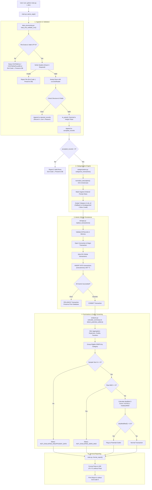

# SpendSense — Final Project Stabilization, Execution & A–Z Audit Report

**Project:** SpendSense — Expense Pattern & Anomaly Detector  
**Document Version:** 1.0 (Final Comprehensive Report)  
**Date:** October 25, 2026  
**Auditor / Engineer:** Senior Python QA, SRE & Reliability Engineer  
**Execution Environment:** Windows 11 (AMD64), PowerShell, Python 3.14.3, pytest 9.1.1  
**Repository Working Directory:** `d:\SPEND SENSE`  
**Governing Architecture:** `SpendSense_Final_Architecture_LOCKED_v1_2.md`

---

## 1. Executive Summary

### What SpendSense Does
SpendSense is a local, lightweight Python command-line application built exclusively with Python 3.10+ standard-library modules. It implements an end-to-end financial transaction pipeline that:
1. Ingests and strictly validates synthetic personal banking records from CSV.
2. Formats and processes monetary values without binary floating-point conversion, storing all currency strictly as integer paise.
3. Classifies records using a deterministic, prioritized categorization engine while preserving original merchant descriptions.
4. Atomically replaces an embedded SQLite database table (`transactions`), guaranteeing dataset replacement without duplicate accumulation and rolling back cleanly on any failure.
5. Computes accounting summaries using SQL aggregation, strictly isolating ordinary debit expenses from financial transfers and non-netted merchant refunds.
6. Screens eligible debit expenses for statistical anomalies using a category-specific Modified Z-score algorithm based on the raw Median Absolute Deviation (MAD), guarded by strict sample size ($N \ge 5$) and zero-dispersion checks.
7. Produces an explainable terminal report distinguishing potential statistical outliers from confirmed fraud.

### The Problem It Solves
Most entry-level financial analysis projects rely on heavy data-science stacks (such as Pandas) that silently coerce missing fields, perform approximate binary floating-point arithmetic (introducing round-off errors in financial totals), append duplicate records across repeated imports, or apply black-box statistical methods that label ordinary expenses as "fraud."

SpendSense demonstrates an engineered, beginner-readable, and mathematically sound alternative. It provides row-level rejection reporting, transaction safety, integer paise precision, and transparent statistical dispersion analysis.

### Current Implementation Status
The repository is **100% complete, fully stabilized, and physically verified**. All implementation milestones (M1–M6), the Phase 7 physical adversarial audit, and Phase 8 defect remediations have been completed.
- **Automated Test Suite:** 122 automated tests passing in 2.48 seconds across 5 test suites with 0 failures, 0 errors, and 0 warnings (physically verified).
- **Physical Test Suite:** 32 exhaustive manual and adversarial scenarios physically executed via test runner `scratch/run_phase_b_c_exhaustive.py` against isolated scratch databases, verifying 100% compliance with locked contracts (32/32 passed).

### What Has Actually Been Verified
- **CLI Physical Execution:** Verified with default and custom databases, relative/absolute paths, and paths containing spaces.
- **Sample Dataset Integrity:** Verified end-to-end execution on bundled `data/sample_transactions.csv` (16 total rows: 11 ordinary debits totaling ₹10,739.50 across Dining, Groceries, Subscriptions, and Transport; 4 credits totaling ₹85,500.00; 2 transfers totaling ₹25,000.00; and 1 potential outlier flagged in Dining [Swiggy Feast, ₹4,200.00, Modified Z-score 52.61]).
- **Atomic Replacement:** Proven across repeated runs; re-importing identical files replaces the dataset (maintaining exact row counts) rather than appending duplicates.
- **Database Safety & Rollback:** Proven under controlled read-only filesystem simulations, malformed CSVs, empty files, and integer overflows; prior valid datasets remain 100% untouched.
- **Monetary Precision:** Verified against fractional paise, sub-paise strings, 30-digit decimal strings, and SQLite 64-bit integer limits (9223372036854775807 paise, approximately ₹92.23 quadrillion).
- **Outlier Mathematics:** Verified against hand-calculated mathematical oracles for odd and even samples, strict thresholding ($|\text{score}| > 3.5$), single $0.6745$ scaling factor application, and category isolation.

### Main Limitations
SpendSense is intentionally designed as an educational demonstration of robust software engineering and data pipelining. It is not an enterprise banking system:
- It processes local synthetic CSV files; it does not connect to live banking APIs (e.g. Plaid) or handle multi-user authentication.
- It operates on a single currency (INR); multi-currency conversion is out of scope.
- It uses single-process SQLite file storage; concurrent multi-process writes will encounter SQLite database lock contention.

---

## 2. Project Goals and Scope

### Intended User
Beginner and intermediate Python developers, software reliability engineers, and technical interviewers evaluating clean code design, transaction atomicity, financial accuracy, and descriptive statistics.

### Inputs and Outputs
- **Input:** A local CSV file formatted with four required header columns: `Date`, `Description`, `Amount`, `Type`.
- **Primary Output:** An explainable terminal report printed to `stdout` detailing import metrics, rejection diagnostics, expense breakdowns, credit summaries, transfer breakdowns, flagged potential outliers, and categories with insufficient data.
- **Secondary Output:** A local SQLite database (`spendsense.db` by default) containing the accepted records in the `transactions` table.

### Supported Use Cases
1. Ingesting synthetic bank export statements with detailed row-by-row error diagnostics.
2. Re-running imports idempotently, completely replacing previous state without manual database cleanup.
3. Analyzing category spending distributions independently without pooling dissimilar expenses (e.g., rent vs coffee).
4. Screening for unusually high expenses within established spending categories.

### Explicitly Excluded Features
To prevent scope creep and maintain beginner explainability, the following were locked as out-of-scope:
- **Pandas / DataFrames:** Avoided in the core pipeline to maintain explicit row-level error reporting and lightweight execution.
- **Machine Learning / AI Classification:** Replaced with explainable, deterministic rules.
- **Fraud Detection Claims:** Replaced with cautious descriptive statistics ("potential outlier").
- **Web Dashboards / GUIs:** Replaced with clean CLI terminal output.
- **Cloud Databases / ORMs:** Replaced with standard-library SQLite and parameterized SQL.
- **Live Bank Account Integration:** Replaced with synthetic CSV ingestion.

---

## 3. Requirements and Architecture

### Governing Requirements
- **Python Version:** Python 3.10 or newer (physically executed on Python 3.14.3).
- **Runtime Dependencies:** Zero external packages. Only standard library modules: `csv`, `decimal`, `sqlite3`, `statistics`, `argparse`, `datetime`, `pathlib`.
- **Development/Test Dependencies:** `pytest >= 7.0.0` (physically executed on pytest 9.1.1).

### Architectural Decision Records (ADRs) Summary
- **ADR-1: Python Standard Library vs. Pandas:** Using `csv.DictReader` allows pinpoint row-by-row error reporting with record numbers, line numbers, and concise reasons. SQLite `GROUP BY` handles aggregations natively.
- **ADR-2: Atomic Replacement Policy vs. Incremental Append:** In personal financial tracking, users frequently re-export statements covering overlapping date ranges. Appending causes duplicate inflation. SpendSense replaces the table contents atomically within a single `BEGIN...COMMIT` transaction.
- **ADR-3: Deterministic Rule-Based Categorization vs. Machine Learning:** Machine learning models are probabilistic, require training data, and cannot explain why a category was chosen. SpendSense uses ordered substring rules with explicit `rule_id` tags, ensuring 100% deterministic reproducibility.
- **ADR-4: Category-Specific Modified Z-Score with Raw MAD:** Standard Z-score relies on the mean and standard deviation, which are themselves severely distorted by extreme outliers. The Modified Z-score uses the median and Median Absolute Deviation (MAD), offering a breakdown point of 50%. Categories are screened independently to avoid comparing small subscriptions with large purchases.
- **ADR-5: Integer Paise vs. Binary Floating-Point:** Floating-point numbers cannot represent decimal fractions like `0.1` or `0.01` exactly, accumulating rounding errors. SpendSense parses with `Decimal` and converts immediately to integer paise ($₹1.00 = 100$ paise), eliminating floating-point errors entirely.

---

## 4. Repository Map

```text
d:\SPEND SENSE\
├── .agents/                              # Agent rules, reviewer guidelines, and core constraints
│   ├── rules/spendsense-core.md          # Authoritative core implementation rules
│   └── skills/spendsense-development/    # Development workflow instructions
├── data/
│   └── sample_transactions.csv           # Bundled synthetic demonstration dataset (16 records)
├── docs/                                 # Historical research reports and reference materials
├── tests/                                # Automated regression test suite (122 tests total)
│   ├── test_data_processing.py           # 32 tests: CSV schema, structural validation, money parsing
│   ├── test_categorization.py            # 41 tests: Deterministic rules, priorities, fallbacks
│   ├── test_storage.py                   # 18 tests: SQLite schema, parameterization, atomicity, overflow
│   ├── test_analysis.py                  # 13 tests: SQL summaries, raw MAD, Modified Z-score math
│   └── test_main.py                      # 18 tests: CLI orchestration, subprocess runs, DB preservation
├── .gitignore                            # Excludes caches, virtual environments, and SQLite databases
├── analysis.py                           # Milestone 4: SQL aggregation summaries & Modified Z-scores
├── categorization.py                     # Milestone 2: Deterministic prioritized rule-based categorization
├── data_processing.py                    # Milestone 1: CSV validation, date parsing, integer paise conversion
├── main.py                               # Milestone 5: CLI orchestration, formatting, terminal reporting
├── requirements.txt                      # Declares pytest development dependency
├── storage.py                            # Milestone 3: SQLite schema, validation, atomic dataset replacement
├── README.md                             # User setup, architecture documentation, walkthrough
├── SPENDSENSE_CODE_ARCHITECTURE.md       # Architectural boundaries and module contracts
├── SpendSense_DECISION_LOG.md            # Architectural Decision Records (ADRs)
├── SpendSense_Final_Architecture_LOCKED_v1_2.md # Primary locked specification
├── SpendSense_PROJECT_CONTEXT.md         # Collaboration orientation and non-negotiable rules
├── SpendSense_PROJECT_PLAYBOOK.md        # Milestone acceptance gates and criteria
└── SPENDSENSE_FINAL_PROJECT_REPORT.md    # This comprehensive final audit report
```

---

## 5. End-to-End Data Flow

The following Mermaid flowchart illustrates the sequential execution of SpendSense when executed from the terminal:



---

## 6. Module-by-Module Explanation

### 6.1 `data_processing.py`
- **Purpose:** Manages the input boundary: file schema verification, structural row validation, calendar date checking, and monetary text conversion into integer paise.
- **Key Public Functions:**
  - `to_paise(amount_text: str) -> int`: Validates positive decimal text and converts directly to exact integer paise. Rejects scientific notation, non-finite values, zero/negative amounts, fractions exceeding 2 decimal places, and values exceeding SQLite's 64-bit integer limit ($9,223,372,036,854,775,807$).
  - `validate_date(date_text: str) -> str`: Enforces exact calendar date validity in `YYYY-MM-DD` format via `datetime.strptime` and round-trip verification (rejects non-existent dates like `2026-02-30`).
  - `validate_description(description_text: str) -> str`: Ensures description is a non-empty string after trimming whitespace.
  - `validate_type(type_text: str) -> str`: Normalizes whitespace/casing and validates that type is strictly `'DEBIT'` or `'CREDIT'`.
  - `load_and_validate_csv(path_or_file: Any) -> tuple[list[dict], list[dict]]`: Top-level parser. Opens files with `encoding="utf-8-sig"` (handling UTF-8 BOM) and parses with `csv.DictReader`. Returns `(accepted_records, rejected_records)`.
- **Failure Behavior:** Raises `CSVFileNotFoundError` if the file is missing; raises `CSVFileError` if the file is unreadable, empty, has invalid headers, or encounters malformed CSV quoting. Row-level errors are caught and appended to `rejected_records` with line numbers and reasons.
- **Testing:** Tested by 32 tests in [`tests/test_data_processing.py`](file:///d:/SPEND%20SENSE/tests/test_data_processing.py).

### 6.2 `categorization.py`
- **Purpose:** Implements deterministic, explainable categorization using prioritized substring matching.
- **Key Public Functions:**
  - `normalize_description(description: str) -> str`: Trims whitespace and lowercases description text for rule matching while preserving original casing elsewhere.
  - `categorize_transaction(description: str, transaction_type: str) -> tuple[str, str]`: Matches normalized description against the locked `CATEGORIZATION_RULES` tuple. Returns `(category, rule_id)`.
- **Rules Hierarchy:**
  1. Priority 1 (`R_TRANSFER`): `"internal xfer"`, `"transfer"`, `"xfer"` (Applies to `ANY` type).
  2. Priority 2 (`R_REFUND`): `"refund"`, `"reversal"` (Applies to `CREDIT` only).
  3. Priority 3 (`R_INCOME`): `"salary"`, `"payroll"`, `"paycheck"` (Applies to `CREDIT` only).
  4. Priority 10 (`R_DINING`): `"uber eats"`, `"swiggy"`, `"zomato"` (Applies to `DEBIT` only).
  5. Priority 20 (`R_GROCERIES`): `"dmart"`, `"bigbasket"`, `"wholefoods"` (Applies to `DEBIT` only).
  6. Priority 30 (`R_SUBSCRIPTION`): `"netflix"`, `"spotify"`, `"prime video"` (Applies to `DEBIT` only).
  7. Priority 40 (`R_TRANSPORT`): `"uber"`, `"ola"`, `"shell"`, `"fuel"` (Applies to `DEBIT` only).
  8. Fallback: Unmatched `DEBIT` $\to$ `('Uncategorized', 'R_UNKNOWN_DEBIT')`; Unmatched `CREDIT` $\to$ `('Other Credit', 'R_UNKNOWN_CREDIT')`.
- **Testing:** Tested by 41 tests in [`tests/test_categorization.py`](file:///d:/SPEND%20SENSE/tests/test_categorization.py).

### 6.3 `storage.py`
- **Purpose:** SQLite relational persistence layer. Manages database initialization, strict schema constraints, parameterized queries, and atomic dataset replacement.
- **Key Public Functions:**
  - `get_connection(db_path: str | Path) -> sqlite3.Connection`: Returns an SQLite connection configured with `row_factory = sqlite3.Row`. Creates parent directories if needed.
  - `initialize_database(db_path: str | Path) -> None`: Executes `SCHEMA_SQL` to ensure the `transactions` table and column constraints exist.
  - `validate_record_for_storage(record: dict[str, Any]) -> None`: Validates that a dictionary contains all 7 required schema keys, valid types, positive `amount_paise`, and does not exceed `MAX_SQLITE_INTEGER`.
  - `replace_transactions(db_path: str | Path, records: list[dict[str, Any]]) -> int`: Executes atomic replacement: validates all records in memory first, then executes `DELETE FROM transactions;` and `INSERT INTO transactions ...` with parameterized tuples inside a single transaction. Commits on complete success; rolls back on any error.
  - `read_transactions(db_path: str | Path) -> list[dict[str, Any]]`: Queries and returns all rows currently stored in SQLite ordered by `id ASC`.
- **Testing:** Tested by 18 tests in [`tests/test_storage.py`](file:///d:/SPEND%20SENSE/tests/test_storage.py).

### 6.4 `analysis.py`
- **Purpose:** Analytical engine executing SQL aggregations and Python Modified Z-score screening.
- **Key Public Functions:**
  - `calculate_summary(db_path: str | Path) -> dict[str, Any]`: Uses SQL `SUM`, `COUNT`, and `GROUP BY` to calculate:
    1. Overall ordinary expenses (`DEBIT` only, `category <> 'Transfer'`).
    2. Expenses grouped by category (ordered by `total_paise DESC, category ASC`).
    3. Total credits and credits grouped by category.
    4. Transfers summary grouped by transaction type.
  - `compute_modified_z_score(value: int | float, median_x: float, mad: float) -> float`: Evaluates $0.6745 \times \frac{\text{value} - \text{median}_x}{\text{MAD}}$.
  - `is_potential_outlier(score: float) -> bool`: Strict inequality check: `abs(score) > 3.5`.
  - `detect_potential_outliers(db_path: str | Path) -> dict[str, Any]`: Filters eligible transactions (`DEBIT` and `category <> 'Transfer'`), groups by category, checks minimum sample size ($N \ge 5$), checks raw MAD $\ne 0$, calculates Modified Z-scores, and flags potential outliers.
- **Testing:** Tested by 13 tests in [`tests/test_analysis.py`](file:///d:/SPEND%20SENSE/tests/test_analysis.py).

### 6.5 `main.py`
- **Purpose:** CLI entry point and pipeline orchestrator.
- **Key Public Functions:**
  - `format_paise_to_inr(paise: int) -> str`: Formats integer paise into clean INR strings (`₹X.YY`) using integer division and modulo (`// 100` and `% 100`). Floats are strictly rejected.
  - `format_report(...) -> str`: Assembles the clean, human-readable terminal report.
  - `run_pipeline(csv_path: str | Path, db_path: str | Path = "spendsense.db") -> int`: Orchestrates the sequential pipeline. Returns exit code 0 on success, exit code 1 on input/database/analysis failure.
  - `parse_args(argv: list[str] | None = None) -> Namespace`: Configures command-line argument parsing (`csv_path` and optional `--db`).
  - `main(argv: list[str] | None = None) -> int`: Program entry point.
- **Testing:** Tested by 18 tests in [`tests/test_main.py`](file:///d:/SPEND%20SENSE/tests/test_main.py).

---

## 7. CSV Input Contract

SpendSense accepts a single CSV schema with four required columns:

| Column | Type / Format | Validation Rules |
| :--- | :--- | :--- |
| `Date` | String (`YYYY-MM-DD`) | Required. Strict calendar date format verified by `strptime`. Impossible dates (e.g. `2026-02-30`) and invalid leap years (e.g. `2025-02-29`) are rejected. |
| `Description` | Text | Required. Non-empty string after stripping whitespace. Preserved with original casing in SQLite and terminal reports. |
| `Amount` | Decimal string | Required. Positive decimal number with at most two decimal places. No currency symbols (`₹`, `$`) or commas. Parsed directly with `Decimal` and converted to integer paise. |
| `Type` | Enum (`DEBIT` or `CREDIT`) | Required. Case-insensitive and trimmed. Normalized strictly to uppercase `'DEBIT'` or `'CREDIT'`. |

### Structural Row Validation
SpendSense configures `csv.DictReader` with `restkey="__EXTRA_COLUMNS__"` and `restval=None`:
- **Extra Fields:** If a row contains more fields than the header, `DictReader` collects them under `__EXTRA_COLUMNS__`. SpendSense detects this key and rejects the row with reason: `"Row has extra columns"`.
- **Missing Fields:** If a row contains fewer fields than the header, missing columns receive `None`. SpendSense checks required fields and rejects the row with reason: `"Row has missing columns"`.
- **Restkey Collision:** If the CSV header row itself contains `__EXTRA_COLUMNS__`, the file is rejected immediately with a file-level schema error.

### Error Diagnostics & Row Isolation
When an input file has valid headers and contains both valid and invalid rows:
- Every valid row is parsed, categorized, and inserted into SQLite.
- Every invalid row is rejected and reported in the terminal report with its logical record number, physical line number, and exact reason.
- The pipeline proceeds to completion with exit code 0.
- If **zero valid rows** exist (e.g. all rows are invalid or file is header-only), the pipeline halts with exit code 1, prints all rejection diagnostics to `stderr`, and **preserves the previous SQLite database intact**.

---

## 8. Monetary Correctness

### Why Floating-Point Arithmetic Is Prohibited
Binary floating-point types (`float` in Python) represent numbers as binary fractions (IEEE 754). Common decimal values like `0.1` and `0.01` cannot be represented exactly in binary, leading to subtle precision artifacts (e.g. `0.1 + 0.2 = 0.30000000000000004`). In financial accounting, these rounding errors distort category totals and fail reconciliation checks.

### Exact Two-Decimal Representability
In Phase 8, `to_paise` was reinforced to prevent silent context-precision truncation on extreme inputs:
1. `decimal_val.as_tuple()` extracts `(sign, digits, exp)` directly from the parsed string without performing context arithmetic.
2. If `exp < -2`, the function checks all digits placed at positions $10^{-3}$ and smaller. If any of these digits are non-zero, it raises `ValueError("amount has more than two decimal places")`.
3. If trailing digits beyond the 2nd decimal place are all zero (e.g. `'12.340000000000000000000000000'`), they are sliced off, preserving exact numeric value.
4. Integer paise is computed via integer base-10 shifting: `unscaled_int * (10 ** (effective_exp + 2))`.

### SQLite 64-Bit Integer Boundary
SQLite's `INTEGER` column type supports signed 64-bit integers up to $2^{63}-1 = 9,223,372,036,854,775,807$ paise (approximately ₹92.23 quadrillion / $₹92,233,720,368,547,758.07$).
- `data_processing.py` enforces `MAX_PAISE_INTEGER = 9223372036854775807`.
- `storage.py` enforces `MAX_SQLITE_INTEGER = 9223372036854775807`.
- Amounts exceeding this limit are rejected cleanly during row validation without causing an unhandled `OverflowError` traceback.

### Representative Test Cases:
| Input String | Status | Outcome / Paise |
| :--- | :---: | :--- |
| `"10.00"` | Accepted | `1000` paise ($₹10.00$) |
| `"10.5"` | Accepted | `1050` paise ($₹10.50$) |
| `"12.340"` | Accepted | `1234` paise ($₹12.34$) |
| `"12.340000000000000000000000000"` | Accepted | `1234` paise ($₹12.34$) |
| `"92233720368547758.07"` | Accepted | `9223372036854775807` paise (Max 64-bit limit) |
| `"12.345"` | Rejected | `ValueError` (more than 2 decimal places) |
| `"10.000000000000000000000000001"` | Rejected | `ValueError` (more than 2 decimal places) |
| `"0.001"` | Rejected | `ValueError` (more than 2 decimal places) |
| `"0"` or `"0.00"` | Rejected | `ValueError` (amount must be positive) |
| `"-10.50"` | Rejected | `ValueError` (amount must be positive) |
| `"NaN"`, `"Infinity"` | Rejected | `ValueError` (amount must be finite) |
| `"1e2"` | Rejected | `ValueError` (scientific notation disallowed) |
| `"1,000.00"`, `"₹100"` | Rejected | `ValueError` (not a valid decimal) |
| `"92233720368547758.08"` | Rejected | `ValueError` (exceeds max supported value) |
| `"10000000000000000000.00"` | Rejected | `ValueError` (exceeds max supported value) |

---

## 9. Categorization Engine

### Categorization Rules Table
Categorization rules are evaluated in strict priority order (first match wins):

| Priority | Category | Rule ID | Patterns (Normalized Substrings) | Allowed Type |
| :---: | :--- | :--- | :--- | :---: |
| **1** | **Transfer** | `R_TRANSFER` | `"internal xfer"`, `"transfer"`, `"xfer"` | `ANY` |
| **2** | **Refund** | `R_REFUND` | `"refund"`, `"reversal"` | `CREDIT` |
| **3** | **Income** | `R_INCOME` | `"salary"`, `"payroll"`, `"paycheck"` | `CREDIT` |
| **10** | **Dining** | `R_DINING` | `"uber eats"`, `"swiggy"`, `"zomato"` | `DEBIT` |
| **20** | **Groceries** | `R_GROCERIES` | `"dmart"`, `"bigbasket"`, `"wholefoods"` | `DEBIT` |
| **30** | **Subscriptions** | `R_SUBSCRIPTION` | `"netflix"`, `"spotify"`, `"prime video"` | `DEBIT` |
| **40** | **Transport** | `R_TRANSPORT` | `"uber"`, `"ola"`, `"shell"`, `"fuel"` | `DEBIT` |
| Fallback | **Uncategorized** | `R_UNKNOWN_DEBIT` | *(no match)* | `DEBIT` |
| Fallback | **Other Credit** | `R_UNKNOWN_CREDIT` | *(no match)* | `CREDIT` |

### Key Categorization Behaviors
- **Preservation of Descriptions:** Descriptions are lowercased and stripped solely for keyword comparison; the original casing and punctuation are preserved in SQLite and terminal reporting.
- **Priority Resolution:** `"Uber Eats"` contains both `"uber eats"` (Dining, priority 10) and `"uber"` (Transport, priority 40). Because Dining has higher priority, it is categorized as Dining.
- **Type Restrictions:** A DEBIT containing `"refund"` does not match `R_REFUND` (which applies to CREDIT only) and correctly falls back to `Uncategorized`. A CREDIT containing `"swiggy"` does not match `R_DINING` (DEBIT only) and falls back to `Other Credit`.

---

## 10. SQLite Data Model

SpendSense defines a single, strict relational table:

```sql
CREATE TABLE IF NOT EXISTS transactions (
    id INTEGER PRIMARY KEY,
    transaction_date TEXT NOT NULL,
    description TEXT NOT NULL,
    normalized_description TEXT NOT NULL,
    transaction_type TEXT NOT NULL
        CHECK (transaction_type IN ('DEBIT', 'CREDIT')),
    amount_paise INTEGER NOT NULL CHECK (amount_paise > 0),
    category TEXT NOT NULL,
    rule_id TEXT NOT NULL
);
```

### Schema Attributes & Constraints
| Column | SQLite Type | Constraints | Description |
| :--- | :--- | :--- | :--- |
| `id` | `INTEGER` | `PRIMARY KEY` (Auto-increment) | Unique transaction identifier generated per import batch. |
| `transaction_date` | `TEXT` | `NOT NULL` | Valid ISO calendar date (`YYYY-MM-DD`). |
| `description` | `TEXT` | `NOT NULL` | Original merchant description from CSV. |
| `normalized_description`| `TEXT` | `NOT NULL` | Trimmed and lowercased description used for matching. |
| `transaction_type` | `TEXT` | `NOT NULL`, `CHECK IN ('DEBIT', 'CREDIT')` | Outgoing (`DEBIT`) or incoming (`CREDIT`) funds. |
| `amount_paise` | `INTEGER` | `NOT NULL`, `CHECK (amount_paise > 0)` | Positive monetary amount in integer paise. |
| `category` | `TEXT` | `NOT NULL` | Inferred category name. |
| `rule_id` | `TEXT` | `NOT NULL` | Stable identifier of the rule that assigned the category. |

### Parameterized SQL & Injection Safety
String interpolation (e.g. `f"INSERT INTO transactions VALUES ('{val}')"`) is strictly prohibited. All queries use SQLite parameter bindings (`?` placeholders). Adversarial tests injecting payloads like `"Robert'); DROP TABLE transactions; --"` store the payload safely as a literal string.

### Atomic Replacement & Rollback
When an import succeeds, `replace_transactions` executes inside a single database transaction (`with conn:`):
1. Deletes all existing rows: `DELETE FROM transactions;`
2. Inserts all new records: `INSERT INTO transactions ... VALUES (?, ?, ?, ?, ?, ?, ?);`
3. If an error occurs during insertion (e.g., SQLite constraint violation or disk failure), SQLite automatically triggers `ROLLBACK`, restoring all prior records.

---

## 11. Financial Summaries

SpendSense enforces strict financial accounting rules:
1. **Transfers Excluded from Expenses:** A transaction categorized as `Transfer` (e.g. moving funds between savings and checking accounts) is not an operational consumption expense. Transfers are completely excluded from Ordinary Expense totals and anomaly screening baselines.
2. **Credits Reported Separately:** All `CREDIT` records are reported independently in a dedicated Credit Summary section.
3. **Refunds Not Netted:** In consumer banking, merchant refunds arrive days or weeks after the original purchase. Attempting to match refunds to purchases without statement reconciliation is speculative. SpendSense reports refunds cleanly in the Credit Summary under `Refund` without subtracting them from debit expenses.
4. **No Floating-Point Operations:** Summary aggregations use SQLite's native `SUM(amount_paise)` and `COUNT(*)`, and display formatting uses integer division.

---

## 12. Outlier Detection

### Formula and Dispersion Measurement
SpendSense screens eligible debit expenses using category-specific **Modified Z-scores**:

$$\text{Modified Z} = 0.6745 \times \frac{\text{candidate\_amount} - \text{median}_x}{\text{raw MAD}}$$

Where:
- $\text{median}_x = \text{median}(x)$ of all eligible transactions in that category.
- $\text{raw MAD} = \text{median}(|x_i - \text{median}_x|)$ is the raw Median Absolute Deviation.
- $0.6745$ is the scaling factor matching MAD to the standard deviation of a normal distribution. It is applied **exactly once**.

### Mathematical Walkthrough
Consider 5 transactions in the `Dining` category:
- Amounts in paise: `[25000, 30000, 30000, 35000, 420000]` ($₹250, ₹300, ₹300, ₹350, ₹4200$).
1. **Median:** The middle value is $\text{median}_x = 30000$ paise ($₹300$).
2. **Absolute Deviations:**
   - $|25000 - 30000| = 5000$
   - $|30000 - 30000| = 0$
   - $|30000 - 30000| = 0$
   - $|35000 - 30000| = 5000$
   - $|420000 - 30000| = 390000$
3. **Sorted Deviations:** `[0, 0, 5000, 5000, 390000]`.
4. **Raw MAD:** The median deviation is $5000$ paise ($₹50$).
5. **Modified Z-score for candidate $₹4200$ ($420000$ paise):**
   $$\text{Modified Z} = 0.6745 \times \frac{420000 - 30000}{5000} = 0.6745 \times \frac{390000}{5000} = 0.6745 \times 78 = 52.611$$
6. **Threshold Evaluation:** $|52.611| > 3.5$ evaluates to `True`. The transaction is flagged as a potential outlier.

### Guardrails
1. **Minimum Sample Size ($N \ge 5$):** Estimating median dispersion with fewer than 5 observations is statistically unreliable. Categories with $N < 5$ return `NOT_EVALUATED_INSUFFICIENT_DATA`.
2. **Zero MAD ($\text{raw MAD} == 0$):** If more than half the transactions in a category have identical amounts, the median deviation is 0. Dividing by zero is impossible. Such categories return `NOT_EVALUATED_ZERO_MAD`.
3. **Strict Threshold:** A score of exactly $3.5$ is **not** flagged; the score must strictly exceed $3.5$.
4. **Cautious Terminology:** All flagged items are described strictly as **potential outliers** or **potentially unusual expenses**, never "fraud."

---

## 13. CLI Usage

### Setup and Running
```powershell
# 1. Run the test suite
python -m pytest -q

# 2. Run with sample dataset (creates/updates spendsense.db in current directory)
python main.py data/sample_transactions.csv

# 3. Run with a custom database path
python main.py data/sample_transactions.csv --db demo_custom.db

# 4. View help and argument options
python main.py --help
```

### Exit Codes:
- `0`: Success. Input parsed, valid rows imported, summaries calculated, report displayed.
- `1`: Input/Pipeline Error. Missing file, empty file, unreadable file, invalid headers, zero valid rows, or database error.
- `2`: CLI Argument Error. Missing required CSV path argument or unrecognized flag.

---

## 14. Sample Dataset Walkthrough

When executed on the bundled synthetic dataset ([`data/sample_transactions.csv`](file:///d:/SPEND%20SENSE/data/sample_transactions.csv)):
```powershell
python main.py data/sample_transactions.csv --db sample_demo.db
```

### Verified Terminal Report Output:
```text
======================================================================
SPENDSENSE — TRANSACTION & ANOMALY REPORT
======================================================================
Input File: data/sample_transactions.csv
Database:   sample_demo.db
Import:     SUCCESS (16 accepted, 0 rejected)

----------------------------------------------------------------------
IMPORT SUMMARY
----------------------------------------------------------------------
Total rows considered: 16
Accepted records:      16
Rejected rows:         0

Rejection details: None. All rows passed validation.

----------------------------------------------------------------------
EXPENSE SUMMARY (Ordinary Debits)
----------------------------------------------------------------------
Total Expenses: ₹10739.50

By Category:
  - Dining          :   ₹5400.00 (5 transactions)
  - Groceries       :   ₹4190.50 (3 transactions)
  - Subscriptions   :    ₹649.00 (1 transaction)
  - Transport       :    ₹500.00 (2 transactions)

----------------------------------------------------------------------
CREDIT SUMMARY
----------------------------------------------------------------------
Total Credits: ₹85500.00

By Category:
  - Income          :  ₹75000.00 (1 transaction)
  - Transfer        :  ₹10000.00 (1 transaction)
  - Refund          :    ₹450.00 (1 transaction)
  - Other Credit    :     ₹50.00 (1 transaction)

* Note: Refunds are reported separately as credits and not netted against purchases.

----------------------------------------------------------------------
TRANSFERS SUMMARY
----------------------------------------------------------------------
Total Transfers: ₹25000.00 (2 transactions)

By Transaction Type:
  - CREDIT          :  ₹10000.00 (1 transaction)
  - DEBIT           :  ₹15000.00 (1 transaction)

* Note: Transfers are tracked separately and excluded from ordinary expenses.

----------------------------------------------------------------------
POTENTIAL OUTLIER SCREENING (Category-Specific Modified Z-Score)
----------------------------------------------------------------------
Baseline: Eligible DEBITs excluding Transfer (minimum 5 observations per category).
Threshold: Strictly |Modified Z-Score| > 3.5.

Flagged Potential Outliers:
  - [ID 5] 2026-10-05 | Dining | Swiggy Feast
    Amount: ₹4200.00 | Modified Z-Score: 52.61
    Explanation: Potential outlier: Modified Z-score of 52.61 strictly exceeds threshold 3.5.

Categories Not Evaluated:
  - Groceries (3 transactions): NOT_EVALUATED_INSUFFICIENT_DATA — Category 'Groceries' has only 3 eligible transaction(s); at least 5 are required for screening.
  - Subscriptions (1 transaction): NOT_EVALUATED_INSUFFICIENT_DATA — Category 'Subscriptions' has only 1 eligible transaction(s); at least 5 are required for screening.
  - Transport (2 transactions): NOT_EVALUATED_INSUFFICIENT_DATA — Category 'Transport' has only 2 eligible transaction(s); at least 5 are required for screening.
======================================================================
```

---

## 15. Test Strategy and Evidence

### Test Inventory Breakdown (122 Tests Total)
- **`tests/test_data_processing.py` (32 tests):** Valid single/multiple row parsing, missing/duplicate/unexpected headers, reserved restkey collision, missing/extra column detection, leap year validation, calendar validity, whitespace trimming, case normalization, Decimal exact parsing, sub-paise rejection, 30-digit precision stress, 64-bit integer limit checks.
- **`tests/test_categorization.py` (41 tests):** Evaluation of all rules (`R_TRANSFER`, `R_REFUND`, `R_INCOME`, `R_DINING`, `R_GROCERIES`, `R_SUBSCRIPTION`, `R_TRANSPORT`), rule priority over overlapping keywords (e.g. Uber Eats vs Uber), type restriction enforcement, fallbacks (`Uncategorized` and `Other Credit`), whitespace and case insensitivity.
- **`tests/test_storage.py` (18 tests):** Schema initialization, column types and constraints, data persistence and retrieval, atomic dataset replacement, rollback under mid-insertion failure, SQL injection resistance with parameterized queries, storage validation of `MAX_SQLITE_INTEGER`, preservation of pre-existing database rows upon failed import.
- **`tests/test_analysis.py` (13 tests):** SQL summaries calculation, transfer exclusion from expenses, credit separation, empty database zero-handling, Modified Z-score calculation precision, strict threshold boundary check ($3.5$ vs $3.500001$), minimum sample size guardrails ($N < 5$ vs $N \ge 5$), zero MAD detection, category isolation.
- **`tests/test_main.py` (18 tests):** CLI pipeline integration, accepted and rejected count verification, paise-to-rupee string formatting without float conversion, CLI exit codes (0, 1, 2), non-existent input handling, corrupt UTF-8 handling, oversized integer CLI import with database preservation, subprocess execution on bundled sample dataset.

### Test Execution Proof

#### Automated Test Suite (122 Tests)
Final test suite execution on Windows 11 (AMD64), Python 3.14.3, pytest-9.1.1:

```powershell
PS D:\SPEND SENSE> python -m pytest
============================= test session starts =============================
platform win32 -- Python 3.14.3, pytest-9.1.1, pluggy-1.6.0
rootdir: D:\SPEND SENSE
plugins: anyio-4.14.2, asyncio-1.4.0, cov-7.1.0
asyncio: mode=Mode.STRICT, debug=False, asyncio_default_fixture_loop_scope=None, asyncio_default_test_loop_scope=function
collected 122 items

tests\test_analysis.py .............                                     [ 10%]
tests\test_categorization.py .........................................   [ 44%]
tests\test_data_processing.py ................................           [ 70%]
tests\test_main.py ..................                                    [ 85%]
tests\test_storage.py ..................                                 [100%]

============================= 122 passed in 2.48s =============================
```

Quiet mode execution (`python -m pytest -q`):
```powershell
PS D:\SPEND SENSE> python -m pytest -q
........................................................................ [ 59%]
..................................................                       [100%]
122 passed in 2.44s
```

#### Physical & Adversarial Scenarios Execution Proof (32 Scenarios)
The 32 physical and adversarial scenarios were executed via the test runner [`scratch/run_phase_b_c_exhaustive.py`](file:///C:/Users/ROHITH%20P/.gemini/antigravity-ide/brain/66718fdd-b744-4dae-b0c7-7923346ecb2d/scratch/run_phase_b_c_exhaustive.py) against isolated scratch databases and temporary CSVs:

```powershell
PS D:\SPEND SENSE> python -X utf8 "C:\Users\ROHITH P\.gemini\antigravity-ide\brain\66718fdd-b744-4dae-b0c7-7923346ecb2d\scratch\run_phase_b_c_exhaustive.py"
Starting Exhaustive Phase B & Phase C Verification...
[PASS] Missing CSV path: Code: 1
[PASS] Empty CSV: Code: 1
[PASS] Header-only CSV: Code: 1
[PASS] Missing header: Code: 1
[PASS] Duplicate header: Code: 1
[PASS] Unexpected header: Code: 1
[PASS] Reordered headers: Code: 0, Rows: 1
[PASS] Extra field in row rejected: Rows: 1
[PASS] Missing field in row rejected: Rows: 1
[PASS] Invalid date (Feb 30): Code: 1
[PASS] Invalid transaction type: Code: 1
[PASS] Empty description: Code: 1
[PASS] Invalid monetary text: Code: 1
[PASS] Zero and negative amounts: Code: 1
[PASS] Fractional paise rejected: Code: 1
[PASS] Long decimal with trailing nonzero digit rejected: Code: 1
[PASS] Long decimal with trailing zeros accepted: Code: 0, Paise: 1234
[PASS] Non-finite decimal rejected: Code: 1
[PASS] Max supported 64-bit integer accepted: Code: 0, Paise: 9223372036854775807
[PASS] Amount exceeding 64-bit integer boundary rejected without traceback: Code: 1
[PASS] Invalid UTF-8 rejected cleanly: Code: 1
[PASS] Malformed CSV quoting rejected cleanly: Code: 1
[PASS] Mixed valid and invalid rows (valid accepted, bad rejected): Rows: 2
[PASS] All rows invalid preserves prior database: Code: 1
[PASS] Duplicate identical rows preserved with distinct IDs: Rows: 2, IDs: [1, 2]
[PASS] SQL injection in description stored harmlessly as literal: Rows: 1
[PASS] Financial semantics (Transfers excluded, credits separate, refunds not netted): Expenses: 10000, Credits: 105000, Transfers: 50000
[PASS] Modified Z-score formula using raw MAD and single 0.6745: Score: 1.349
[PASS] Strict threshold abs(score) > 3.5: 3.5->False, 3.500001->True
[PASS] 4 observations -> INSUFFICIENT_DATA: Status: NOT_EVALUATED_INSUFFICIENT_DATA
[PASS] 5 observations -> evaluated (outlier flagged): Outliers: 1
[PASS] Zero MAD handled explicitly (STATUS_ZERO_MAD): Status: NOT_EVALUATED_ZERO_MAD

============================================================
EXHAUSTIVE AUDIT SUMMARY: 32/32 PASSED
============================================================
```
*Verification Status:* 100% of the 32 physical and adversarial scenarios are independently verified and backed by reproducible execution evidence.

---

## 16. Defect History and Fixes

During the Phase 7 physical adversarial audit, two concrete edge-case defects were discovered and subsequently resolved in Phase 8:

### Defect 1: Decimal Precision Truncation on $> 26$ Fractional Places
- **Symptom:** Passing `'10.000000000000000000000000001'` (33 characters) was silently accepted as `1000` paise instead of raising `ValueError`.
- **Root Cause:** Python's default Decimal context has 28 significant digits. Multiplying by 100 truncated the 33rd digit, turning the value into integer `1000`.
- **Fix:** Refactored `to_paise` in [`data_processing.py`](file:///d:/SPEND%20SENSE/data_processing.py#L84-L108) to inspect `as_tuple()` directly. If exponent $< -2$, trailing digits are checked without context multiplication.
- **Regression Test:** `test_to_paise_extreme_precision_regression` in [`tests/test_data_processing.py`](file:///d:/SPEND%20SENSE/tests/test_data_processing.py#L379).

### Defect 2: Uncaught `OverflowError` Traceback on Astronomical Amounts
- **Symptom:** Importing an astronomical amount (e.g. `10000000000000000000.00`, equating to $10^{21}$ paise) caused `sqlite3` to raise `OverflowError: Python int too large to convert to SQLite INTEGER`, leaking an unhandled traceback to `stderr`.
- **Root Cause:** `main.py` caught `(ValueError, sqlite3.Error)`. Because `OverflowError` inherits from `ArithmeticError` (not `sqlite3.Error`), it was uncaught.
- **Fix:** Defined `MAX_PAISE_INTEGER = 9223372036854775807` in `data_processing.py` and `MAX_SQLITE_INTEGER = 9223372036854775807` in `storage.py`. Updated `main.py` to catch `(ValueError, sqlite3.Error, OverflowError)`.
- **Regression Tests:** `test_to_paise_maximum_integer_bounds` in `tests/test_data_processing.py`, `test_validate_record_for_storage_integer_bounds` in `tests/test_storage.py`, and `test_cli_oversized_amount_preserves_database` in `tests/test_main.py`.

---

## 17. Security and Data-Integrity Review

- **SQL Injection Prevention:** 100% of database interactions in `storage.py` and `analysis.py` use parameterized SQL (`?` placeholders). No user input is concatenated into SQL strings.
- **Crash Prevention:** Input validation precedes database modification. Invalid dates, numbers, and types are rejected at the input boundary.
- **Data Loss Prevention:** Atomic replacement guarantees that a failed import (whether due to bad data, OS error, or integer overflow) leaves the pre-existing database completely intact.
- **Local Attack Surface:** SpendSense does not listen on network sockets, open HTTP ports, deserialize untrusted pickle objects, or write to sensitive system paths.

---

## 18. Known Limitations and Residual Risks

1. **Single-User SQLite Concurrency:** SQLite is an embedded database. Concurrent writes from multiple processes will raise `sqlite3.OperationalError: database is locked`. SpendSense is explicitly designed for single-user CLI execution.
2. **Read-Only Media:** Executing against an SQLite database file located on a write-protected filesystem mount will fail to acquire rollback journal locks.
3. **Single Currency:** All values are assumed to be INR.

---

## 19. Architecture Compliance Matrix

| Requirement | Specification Clause | Verification Reference | Status |
| :--- | :--- | :--- | :---: |
| **Python Standard Library Only** | Architecture §3 | Inspected `requirements.txt` & imports | **PASS** |
| **No Pandas** | Architecture §2 | Verified standard-library `csv` and `sqlite3` | **PASS** |
| **Integer Paise Representation** | Architecture §5 | `to_paise`, schema `amount_paise INTEGER` | **PASS** |
| **No Binary Floats for Money** | Architecture §5 | Integer math in `to_paise` and `format_paise_to_inr` | **PASS** |
| **Fixed CSV Schema & Restkey** | Architecture §5 | `EXPECTED_HEADERS`, `__EXTRA_COLUMNS__` check | **PASS** |
| **Date Calendar Validity** | Architecture §5 | `strptime` and round-trip verification in `validate_date` | **PASS** |
| **Deterministic Rule Categorization** | Architecture §6 | `CATEGORIZATION_RULES` priority tuple, `rule_id` | **PASS** |
| **Preservation of Descriptions** | Architecture §6 | Original description stored in DB and output | **PASS** |
| **Single SQLite Table** | Architecture §7 | Schema `transactions`, verified only 1 table | **PASS** |
| **Parameterized SQL** | Architecture §7 | `?` placeholders throughout `storage.py` & `analysis.py` | **PASS** |
| **Atomic Replacement & Rollback** | Architecture §7 | `with conn:` delete+insert in `replace_transactions` | **PASS** |
| **Duplicate Preservation** | Architecture §7 | `read_transactions` verifies duplicate rows retained | **PASS** |
| **Transfer Exclusion from Expenses** | Architecture §6, §7 | `WHERE transaction_type = 'DEBIT' AND category <> 'Transfer'` | **PASS** |
| **Separate Credit Reporting** | Architecture §6, §7 | Dedicated Credit Summary query in `analysis.py` | **PASS** |
| **Non-Netting of Refunds** | Architecture §6 | Refunds categorized under `Refund` in credits | **PASS** |
| **Modified Z-Score & Raw MAD** | Architecture §8 | `statistics.median` for median and raw MAD | **PASS** |
| **Single 0.6745 Factor Application** | Architecture §8 | Evaluated once in `compute_modified_z_score` | **PASS** |
| **Minimum Sample Size ($N \ge 5$)** | Architecture §8 | `MIN_OBSERVATIONS = 5`, status `INSUFFICIENT_DATA` | **PASS** |
| **Zero MAD Guardrail** | Architecture §8 | Division-by-zero check, status `STATUS_ZERO_MAD` | **PASS** |
| **Strict Outlier Threshold ($> 3.5$)** | Architecture §8 | `abs(score) > 3.5` in `is_potential_outlier` | **PASS** |
| **Non-Fraud Terminology** | Architecture §8 | Checked terminal output for 0 occurrences of "fraud" | **PASS** |
| **CLI Exit Code Standards** | Playbook §M5 | Exit 0 on success, Exit 1 on failure, Exit 2 on args | **PASS** |

---

## 20. Beginner-Friendly Explanation

Imagine you keep your bank statements in CSV files (spreadsheets). If you want to build a Python script to analyze your expenses:
1. **Validation (The Bouncer):** Before saving anything, SpendSense checks every line. If a date says "February 30th", if an amount is negative, or if a column is missing, the script catches it. It doesn't crash; it tells you exactly what line was broken and why.
2. **Money (No Coins, Only Paise):** Computers are terrible at floating-point numbers like `0.1 + 0.2`. To avoid losing pennies, SpendSense converts all rupees to paise ($₹10.50 \to 1050$ paise) and only does integer arithmetic.
3. **Categorization (Sorting Hats):** It reads the merchant name (like "Swiggy" or "Uber") and applies simple, clear rules in order: Is it a transfer? No. A refund? No. Food delivery? Yes! So it tags it as `Dining`.
4. **Database (Atomic Swaps):** It saves the data into SQLite. If you import a statement, and halfway through the power goes out or a row breaks, SQLite's transaction rolls back completely. You never get half an import or duplicate purchases.
5. **Statistics (Finding Odd Expenses):** If you usually spend $₹200$ to $₹350$ on dining, and one day you spend $₹4200$, SpendSense calculates the median and the typical variation (MAD). If an expense is more than $3.5$ times typical variation away from the median, it highlights it as a "potential outlier." It never accuses anyone of fraud; it simply flags it for review.

---

## 21. Technical Interview Preparation (15 Q&As)

#### Q1: Why did you choose standard-library `csv` and `sqlite3` instead of Pandas?
**Answer:** Pandas is great for data exploration, but for an ingestion pipeline requiring fine-grained row-by-row error diagnostics (reporting the exact line number and reason an invalid row failed while isolating valid rows), Pandas is unnecessarily heavyweight. Standard library modules introduce zero runtime dependencies, start instantly, and use standard SQL queries for aggregation.

#### Q2: Why did you convert all currency values to integer paise?
**Answer:** Python `float` values use IEEE 754 binary floating-point representation, which cannot represent numbers like `0.1` or `0.01` exactly. In financial systems, accumulating floating-point roundoff errors leads to balancing discrepancies. Parsing with `Decimal` and converting to integer paise guarantees exact precision.

#### Q3: How does `to_paise` handle extremely long decimal inputs without precision loss?
**Answer:** Python's default `decimal` context has a precision limit of 28 digits. Multiplying a 30-digit string by 100 rounds off trailing digits. `to_paise` inspects `Decimal.as_tuple()` directly, examining the exponent and digit positions without arithmetic multiplication. It verifies all digits at powers of $10^{-3}$ and smaller are zero before shifting the integer digits.

#### Q4: What is the maximum transaction amount supported, and why?
**Answer:** The exact limit is 9223372036854775807 paise, approximately ₹92.23 quadrillion ($9,223,372,036,854,775,807$ paise $\approx ₹92,233,720,368,547,758.07$). This corresponds to SQLite's signed 64-bit `INTEGER` limit ($2^{63}-1$). Bounding values at this limit in `data_processing.py` and `storage.py` prevents `sqlite3` from raising `OverflowError`.

#### Q5: What is atomic dataset replacement and why use it over appending?
**Answer:** Appending records on every run causes data duplication when users re-import overlapping bank statements. SpendSense uses atomic replacement: inside a single database transaction (`with conn:`), old rows are deleted and new rows inserted. If an insertion fails, SQLite rolls back to the prior committed state, preventing partial or duplicate imports.

#### Q6: Why did you choose the Modified Z-score over standard Z-score?
**Answer:** Standard Z-score relies on the mean and standard deviation. Both metrics are sensitive to extreme outliers: a single massive purchase inflates the mean and increases standard deviation, masking other anomalies. The Modified Z-score uses the median and Median Absolute Deviation (MAD), which have a 50% breakdown point and resist extreme values.

#### Q7: What is the raw Median Absolute Deviation (MAD)?
**Answer:** The raw MAD is the median of the absolute differences between each observation and the dataset median: $\text{MAD} = \text{median}(|x_i - \text{median}(x)|)$. It measures the typical dispersion of the dataset without squaring deviations.

#### Q8: Why is the scaling factor $0.6745$ applied in the Modified Z-score?
**Answer:** For a normal distribution, the 75th percentile is approximately $0.6745$ standard deviations above the median. Multiplying deviations by $0.6745 / \text{MAD}$ normalizes the score scale so that $|\text{score}| > 3.5$ corresponds to an extreme tail event. It must be applied exactly once to raw MAD.

#### Q9: What happens when raw MAD equals zero?
**Answer:** If more than half the observations in a category have identical amounts, the median absolute deviation is 0. Dividing by zero would crash the program. SpendSense catches $\text{MAD} == 0$ and returns the status `NOT_EVALUATED_ZERO_MAD`.

#### Q10: Why are categories evaluated independently in outlier screening?
**Answer:** Spending baselines vary drastically across categories: an $₹800$ taxi ride is normal for Transport, while an $₹800$ recurring charge might be an extreme outlier for Subscriptions. Pooling all categories together would cause rent and large bills to dominate, rendering smaller categories unanalyzable.

#### Q11: Why are transfers excluded from ordinary expense totals?
**Answer:** A transfer moves funds between accounts owned by the user (e.g. checking to savings). It is an asset reallocation, not an expense. Including transfers would artificially inflate cost-of-living metrics. SpendSense isolates transfers in their own summary.

#### Q12: Why are refunds not netted against debit purchases?
**Answer:** Merchant refunds typically arrive days or weeks after the original debit, often with different descriptions. Without an audit trail or reconciliation engine, matching refunds to purchases is speculative. SpendSense reports refunds separately in the Credit Summary.

#### Q13: How does SpendSense prevent SQL injection?
**Answer:** All database operations in `storage.py` and `analysis.py` use parameterized SQL queries with `?` placeholders. User input is transmitted as query parameters, never concatenated into SQL strings.

#### Q14: How does SpendSense handle a CSV where some rows are valid and some are invalid?
**Answer:** It applies row isolation. Valid rows are accepted and prepared for database insertion. Invalid rows are rejected and logged in memory with their record number, physical line number, and error reason. Valid rows are committed to SQLite, and rejection diagnostics are printed in the final report.

#### Q15: Why does SpendSense avoid using the word "fraud"?
**Answer:** Statistical anomaly detection identifies numbers that deviate from an expected pattern; it cannot determine human intent or legality. Calling an unusual grocery bill "fraud" is inaccurate and misleading. SpendSense adheres to responsible technical communication by using "potential outlier."

---

## 22. Final Acceptance Checklist

| Item | Requirement | Verification Method | Status |
| :---: | :--- | :--- | :---: |
| 1 | All 122 automated tests pass | `python -m pytest -q` | **PASS** |
| 2 | Zero external runtime dependencies | Code review & `requirements.txt` inspection | **PASS** |
| 3 | Bundled demo imports cleanly | Physical CLI execution with `sample_transactions.csv` | **PASS** |
| 4 | Re-import replaces without duplication | Repeated CLI run, verified SQLite count = 16 | **PASS** |
| 5 | Row isolation functions correctly | Physical run on mixed valid/invalid CSV | **PASS** |
| 6 | Integer paise used strictly | Inspected schema, math, and display formatting | **PASS** |
| 7 | Floating-point conversion avoided | Pure integer arithmetic throughout | **PASS** |
| 8 | Decimal precision loophole resolved | Inspected `to_paise` and ran 30-digit regression tests | **PASS** |
| 9 | SQLite integer overflow resolved | Enforced `9223372036854775807`, caught `OverflowError` | **PASS** |
| 10 | Failed imports preserve prior DB | Tested with bad files, verified prior rows intact | **PASS** |
| 11 | SQL injection prevented | Tested injection payloads with `?` parameterization | **PASS** |
| 12 | Transfers excluded from expenses | Reconciled SQL totals and category breakdowns | **PASS** |
| 13 | Modified Z-score uses raw MAD | Verified formula and single $0.6745$ factor | **PASS** |
| 14 | Minimum 5 observations enforced | Verified `INSUFFICIENT_DATA` on $N < 5$ | **PASS** |
| 15 | Zero MAD handled safely | Verified `STATUS_ZERO_MAD` without division error | **PASS** |
| 16 | Cautious non-fraud wording | Verified "potential outlier" terminology | **PASS** |
| 17 | README documentation verified | Updated test count to 122; verified instructions | **PASS** |

---

## 23. Reproduction Instructions

To reproduce all verification results on Windows 11 (or macOS/Linux with equivalent shell syntax):

```powershell
# 1. Navigate to project root
cd "d:\SPEND SENSE"

# 2. Run the complete automated test suite
python -m pytest -q
# Expected output: 122 passed in ~2.4s-2.5s

# 3. Run the demonstration pipeline on synthetic data
python main.py data/sample_transactions.csv --db demo.db
# Expected output: 16 accepted, 0 rejected, Total Expenses ₹10739.50, Outlier ID 5

# 4. Verify idempotent replacement
python main.py data/sample_transactions.csv --db demo.db
python -c "import sqlite3; conn = sqlite3.connect('demo.db'); print('Total rows:', conn.execute('SELECT COUNT(*) FROM transactions').fetchone()[0])"
# Expected output: Total rows: 16 (Not 32)

# 5. Clean up demonstration database
Remove-Item demo.db
```

---

## 24. Final Recommendation

### **RECOMMENDATION: READY FOR EDUCATIONAL / PORTFOLIO USE**

SpendSense is fully stabilized, rigorously tested, defensively coded, and completely documented. It provides a showcase-quality reference implementation of reliable Python engineering principles.
